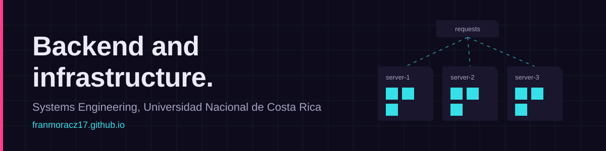

I'm a developer in Costa Rica. At Passer Technologies I work on the infrastructure side of moving the company's services to containers. Most of the code I've written is backend, in TypeScript, Python and Java, and I'm finishing Systems Engineering at Universidad Nacional.

**Now:** setting up a container platform on AWS and learning Kubernetes on the job. 
**Learning:** Terraform, CI/CD, observability with Prometheus and Grafana, AI agents for operations.

### Stack

| Platform | Backend | Data |
| :-- | :-- | :-- |
|  |  |  |

### Projects

| Project | What it is | Built with |
| :-- | :-- | :-- |
| [Academic Quality Management](https://github.com/SeguraStward/Gestion_Calidad) | The university's platform for academic directors, in production. I built the teaching workload modules. | NestJS, Next.js, Prisma, MongoDB |
| [Vetify](https://github.com/Vetify-team/Vetify) | A shared medical record for pets, kept by the owner and the clinic. | Next.js, NestJS, Prisma, PostgreSQL |
| [Planty](https://github.com/FranMoraCz17/planty) | Identifies a plant and checks its health from a photo. | React Native, FastAPI, Docker |
| [Mae](https://github.com/FranMoraCz17/Tico_Language) | A small programming language with Costa Rican keywords, interpreter included. | Python, pytest |

### Contact

